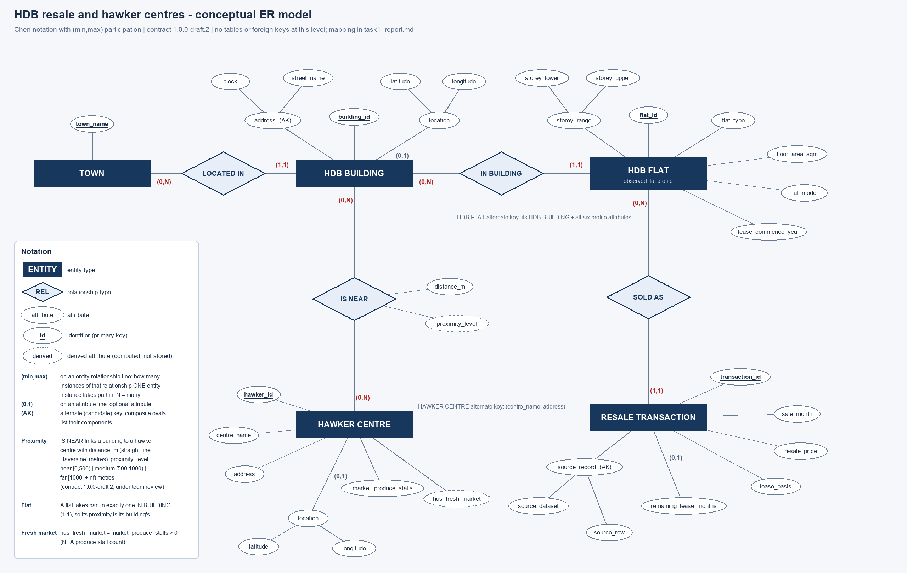
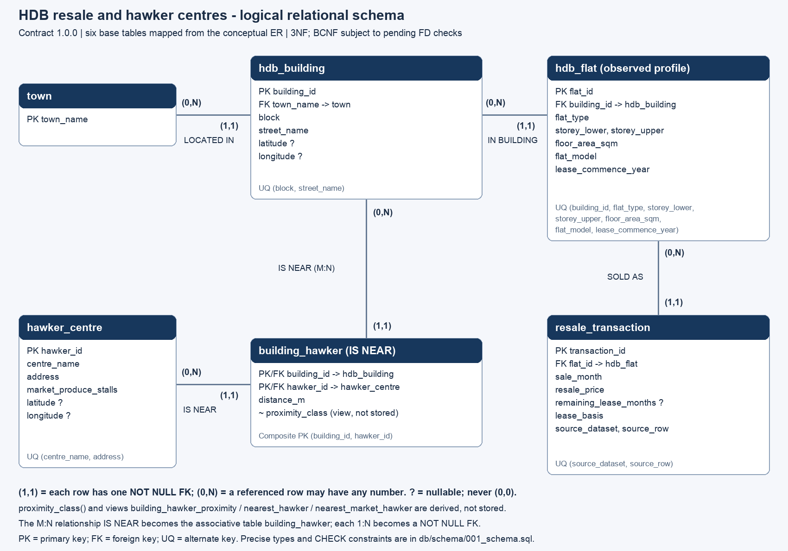

# Task 1: Conceptual modelling, logical design and implementation

**Contribution:** WU JUDNE, Database Architect and Technical Lead.
**Contract:** `1.0.0`, frozen at Gate 0 (2026-10-30) with Chen, LI and WU's agreement.
**Status:**
- The conceptual ER, the relational schema and the DDL describe the same model; the mapping
  is in Section 4.
- Facts that still need confirmation on the full five-file data are marked
  **[Pending Validation]**.

## 1. Modelling assumptions

| Assumption | Detail |
|---|---|
| HDB Flat is an *observed flat profile* | The resale data has no unit number or dwelling identifier. A flat is the combination of building, flat type, storey range, floor area, flat model and lease commencement year seen in a sale. Two identical-looking homes share a profile. Repeat sales of one dwelling cannot be inferred. Each resale record stays a distinct transaction, identified by its source dataset and record ordinal. |
| HDB Building | A fifth entity that carries address, town and coordinates. These are shared by every profile in a block. |
| Town | The HDB town name in the resale data; not the URA planning area in hdb.csv. |
| Hawker Centre identity | NEA `name_of_centre` + `location_of_centre`. Fresh-market eligibility comes from the NEA produce-stall count. The NTULearn `hawker_geo.csv` supplies coordinates only. |

## 2. Conceptual ER model



Editable sources: [conceptual_er.drawio](conceptual_er.drawio) (diagrams.net) and
[conceptual_er.svg](conceptual_er.svg).

The notation is Chen-style:
- rectangles are entity types, diamonds relationship types, ovals attributes;
- an underlined attribute is the identifier, and dashed ovals are derived attributes;
- composite attributes branch into their components, and `(AK)` marks an alternate key.

A (min,max) pair on an entity–relationship line states how many instances of that relationship
**one** entity instance takes part in. `(0,1)` on an attribute line marks an optional attribute.

| Relationship | Participation | Meaning |
|---|---|---|
| LOCATED IN (HDB BUILDING – TOWN), 1:N | Building (1,1); Town (0,N) | Every building lies in exactly one town; a town may have any number of buildings. |
| IN BUILDING (HDB FLAT – HDB BUILDING), 1:N | Flat (1,1); Building (0,N) | Every flat profile belongs to exactly one building. |
| SOLD AS (RESALE TRANSACTION – HDB FLAT), 1:N | Transaction (1,1); Flat (0,N) | Every sale is of exactly one flat profile. |
| IS NEAR (HDB BUILDING – HAWKER CENTRE), M:N | Building (0,N); Centre (0,N) | One instance per geocoded building and geocoded centre pair. Attribute `distance_m`; derived attribute `proximity_level`. |

**How proximity links flats to hawker centres.** Distance depends on location, and location is a
property of the building. A flat takes part in exactly one IN BUILDING instance (1,1), so its
proximity to every centre is exactly its building's IS NEAR instances. Attaching IS NEAR directly
to HDB FLAT would repeat the same distance for every profile in a block: that is the transitive
dependency flat → building → distance. The flat-level view is therefore derived through the
(1,1) participation rather than stored.

**Minimum participation 0.** These are deliberate:
- A town or building can exist before its children are loaded.
- An ungeocoded building or centre has no IS NEAR instances. It is not a "far" one.
- Under the current contract, every geocoded building is paired with every geocoded centre, which
  is consistent with (0,N) on both sides.

## 3. Proximity definition

| Element | Definition |
|---|---|
| Distance | Straight-line great-circle (Haversine) distance in metres between WGS84 coordinates. Mean Earth radius R = 6,371,008.8 m. |
| Formula | a = sin²(Δφ/2) + cos φ₁ · cos φ₂ · sin²(Δλ/2); d = 2R · asin(√clamp(a, 0, 1)). Angles in radians. |
| Coordinates | Buildings: prescribed `hdb.csv`. Centres: `hawker_geo.csv`, through the crosswalk approved by Chen (104 of the 107 NEA centres). |
| Three levels | **near** 0 ≤ d < 500 m; **medium** 500 ≤ d < 1000 m; **far** 1000 ≤ d ≤ 2000 m. Exactly 500 m is medium; exactly 1000 m and exactly 2000 m are far. Distances are never rounded before classification. |
| Maximum effective distance | Beyond **2,000 m** there is no proximity relationship: the class is NULL, and the sale is excluded from Q4's near/far averages and from Q5. Missing coordinates also mean *unclassified*, never far. |
| Q4 | A sale takes the class of its building's **nearest** geocoded centre. |
| Q5 | A sale takes the class of its building's nearest centre **with produce stalls > 0**. |
| Ties | The smallest centre UUID wins. The class does not depend on which centre wins the tie. |
| Double counting | One centre is chosen per building *before* sales are joined, so no sale is counted twice. |

How the thresholds were chosen ([decision F-03](proposals/F03_proximity_semantics.md)):
- **500 m and 1,000 m:** walking-scale distances, confirmed by Chen against the real
  nearest-centre distances.
- **The 2,000 m cap:** gives Q5's "in proximity to a hawker with fresh market stalls" a real
  meaning. Without it, a flat 20 km away would still count as `far`. It follows the agreed rule:
  the 95th percentile of the nearest fresh-market distance (5.1–5.3 km), capped at 2,000 m.
- **The cost:** about 29% of the transactions in the five files have no proximity class. They
  remain in all other queries.

Hawker inventory ([decision F-02](proposals/F02_hawker_coverage.md)):
- Only the 107 NEA centres are used. The NEA list dates from 2016 and about 75% of transactions
  are earlier, so adding the 25 newer centres from `hawker_geo.csv` would compare older sales with
  centres that did not yet exist.
- Three NEA centres could not be matched and have no coordinates.

## 4. Logical relational schema and mapping



Editable sources: [er_diagram.drawio](er_diagram.drawio) and [er_diagram.svg](er_diagram.svg).
Underline = primary key, `UQ` = alternate key, `→` = foreign key, `?` = nullable.

```text
town(town_name)
hdb_building(building_id, town_name → town, block, street_name, latitude?, longitude?)
    UQ(block, street_name)
hdb_flat(flat_id, building_id → hdb_building, flat_type, storey_lower, storey_upper,
         floor_area_sqm, flat_model, lease_commence_year)
    UQ(building_id, flat_type, storey_lower, storey_upper, floor_area_sqm, flat_model, lease_commence_year)
resale_transaction(transaction_id, flat_id → hdb_flat, sale_month, resale_price,
                   remaining_lease_months?, lease_basis, source_dataset, source_row)
    UQ(source_dataset, source_row)
hawker_centre(hawker_id, centre_name, address, market_produce_stalls, latitude?, longitude?)
    UQ(centre_name, address)
building_hawker(building_id → hdb_building, hawker_id → hawker_centre, distance_m)
    PK(building_id, hawker_id)
```

| Conceptual construct | Relational mapping | Enforced by |
|---|---|---|
| Entity type | One table per entity (5 tables) | — |
| Identifier | Primary key: a deterministic UUIDv5 of the natural key; `town_name` for TOWN | PRIMARY KEY |
| Alternate key (AK) | UNIQUE constraint. For HDB FLAT, the key includes the IN BUILDING FK. | UNIQUE |
| Composite attribute (address, storey_range, location, source_record) | Flattened into its component columns | — |
| Optional attribute `(0,1)` | Nullable column(s). Location: both NULL or both set, never (0,0). | CHECK |
| 1:N relationship with (1,1) on the N side | NOT NULL foreign key on the (1,1) side, ON DELETE RESTRICT | FOREIGN KEY + NOT NULL |
| (0,N) on the 1 side | No constraint needed: a parent may have no children | — |
| M:N relationship IS NEAR | Associative table `building_hawker` with composite PK of both FKs | PK + 2 FKs |
| Relationship attribute `distance_m` | NOT NULL column of the associative table | CHECK 0 … 20,015,115 m |
| Derived `proximity_level` | Not stored. `housing.proximity_class(distance_m)` (NULL beyond 2,000 m) and view `building_hawker_proximity`. | IMMUTABLE function |
| Derived `has_fresh_market` | Not stored. Predicate `market_produce_stalls > 0` in view `nearest_market_hawker`. | View |
| Q4/Q5 "nearest" semantics | Query-level views `nearest_hawker`, `nearest_market_hawker`, not ER constructs. They pick one centre per building with `DISTINCT ON`, then compute its class. | Views |

The full IS NEAR population (every geocoded building × every geocoded centre) and the agreement of
`distance_m` with the stored coordinates are cross-table facts. They are verified by the read-only
`db/schema/validate_loaded_data.sql`, not by a CHECK constraint.

## 5. Normalisation

All dependencies are classified in [design_decisions.md §D2](design_decisions.md) as
**semantic**, **code-enforced** or **Pending Validation**.

- Under the declared keys, all six relations are in **BCNF, hence 3NF**. Every non-trivial
  determinant is a candidate key.
- Two plausible extra dependencies are **[Pending Validation]** against the five resale files and
  hdb.csv:
  1. **building → lease_commence_year.** If it holds, `hdb_flat` is **3NF but not BCNF**. It stays
     3NF because `lease_commence_year` is part of the profile key, so it is prime. The BCNF repair
     (moving the attribute to `hdb_building`) would change the flat key and CSVs, so it is
     a team decision (HE, LI, Sun) if the probe confirms the dependency.
  2. **(latitude, longitude) → town_name.** This is harmless while each coordinate pair identifies
     one building. A shared pair would indicate a geocoding defect.
- `validate_loaded_data.sql` reports both probes on every loaded stage. The accurate claim today
  is therefore **"3NF; BCNF under stated assumptions (Pending Validation)"**.

Derived values (proximity class, fresh-market eligibility) are not stored. Town, address and
coordinates are not repeated in flats or sales. Distance is stored once per building–centre pair,
not once per flat or sale.

## 6. Constraints

| Category | Constraints |
|---|---|
| Keys | 6 primary keys, 4 alternate keys (UNIQUE), 5 foreign keys, all ON DELETE RESTRICT / ON UPDATE NO ACTION |
| Text | Domain `canonical_text`: non-empty, upper case, single spaces. The Python ID helper (`db/schema/contract.py`) produces the same canonical form. |
| Value domains | `flat_type` in 7 labels. Storeys positive with lower ≤ upper. Area, price and distance finite and positive/non-negative (NaN and ±∞ rejected). Sale month is the first of a month. Remaining lease 0–1188 months. `lease_basis` in 4 states, with matching NULL/whole-year rules. Dataset id `d_` + 32 hex digits. Source row > 0. Produce stalls ≥ 0. |
| Coordinates | Latitude/longitude paired (both or neither), within ±90/±180, **not (0,0)** (new in draft.2) |
| Deliberately not added | Singapore bounding box, year/storey/area/price ranges. They would be new business rules, and no real HDB data is available to show they cannot reject valid rows. Candidate bounds and how to validate them are in [design_decisions.md §D5](design_decisions.md). |
| Producer-side | `numeric(p,s)` rounds excess decimals on input, so producers must validate precision before COPY (`contract.decimal_2`) |

## 7. Implementation

Create a new database (from the project root):

```sh
psql -X -v ON_ERROR_STOP=1 -d postgres -v database_name=sd6105_housing -f db/schema/create_database.sql
```

`001_schema.sql` alone can also be run in an existing empty database (for example in pgAdmin).
Both scripts fail instead of overwriting an existing `housing` schema.

After a data stage is loaded, `db/schema/validate_loaded_data.sql` (read-only) checks that the
IS NEAR matrix is complete and that each `distance_m` agrees with the stored coordinates. It also
reports missing coordinates, unknown leases and the dependency probes from Section 5.

Since 1.0.0 the script also reports how many buildings have their nearest centre, or nearest
fresh-market centre, beyond 2,000 m. Stage 1 (37,153 transactions, 821,912 building–hawker
pairs) has been loaded with the HDB and spatial CSVs and passes this check.

**[Pending Validation]** The Section 5 dependency probes still need to be read on the full
five-file database.

## 8. Limitations

- The hawker inventory is a static 2016 NEA list, and `hdb.csv` is a historical building snapshot.
  Neither establishes access at a sale date or a causal price effect. Newer estates lose nearby
  centres that opened after 2016 (decision F-02).
- About 29% of transactions are beyond the 2,000 m maximum effective distance and have no
  proximity class.
- Distances are straight-line, not walking routes.
- Month markers follow the source: approval month before March 2012, registration month after.

## 9. Complete database creation SQL

<!-- BEGIN GENERATED SQL: copied byte-for-byte from db/schema -->

`db/schema/create_database.sql`:

```sql
-- Run once using psql against a maintenance database. Existing DBs are not reset.
\set ON_ERROR_STOP on
\if :{?database_name}
\else
  \set database_name sd6105_housing
\endif
CREATE DATABASE :"database_name" TEMPLATE template0 ENCODING 'UTF8';
\connect :database_name
\ir 001_schema.sql
```

`db/schema/001_schema.sql`:

```sql
-- Contract 1.0.0 (Gate 0 freeze). PostgreSQL 15+. Intentionally fails if housing exists.
-- No extensions, seed data, optional indexes, destructive reset, or ETL required.
BEGIN;
CREATE SCHEMA housing;
COMMENT ON SCHEMA housing IS 'Housing schema contract 1.0.0; frozen at Gate 0 for the Task 3 baseline';

CREATE DOMAIN housing.canonical_text AS text
    CHECK (VALUE = upper(VALUE)
           AND VALUE ~ '^[^[:space:]]+( [^[:space:]]+)*$');

CREATE TABLE housing.town (
    town_name housing.canonical_text PRIMARY KEY
);

CREATE TABLE housing.hdb_building (
    building_id uuid PRIMARY KEY,
    town_name housing.canonical_text NOT NULL REFERENCES housing.town ON DELETE RESTRICT,
    block housing.canonical_text NOT NULL,
    street_name housing.canonical_text NOT NULL,
    latitude double precision,
    longitude double precision,
    CONSTRAINT building_address_key UNIQUE (block, street_name),
    CONSTRAINT building_coordinate_pair CHECK ((latitude IS NULL) = (longitude IS NULL)),
    CONSTRAINT building_latitude CHECK (latitude BETWEEN -90 AND 90),
    CONSTRAINT building_longitude CHECK (longitude BETWEEN -180 AND 180),
    -- Contract: no zero-coordinate sentinels; unknown location is NULL, not (0,0).
    CONSTRAINT building_not_zero_sentinel CHECK (NOT (latitude = 0 AND longitude = 0))
);

CREATE TABLE housing.hdb_flat (
    flat_id uuid PRIMARY KEY,
    building_id uuid NOT NULL REFERENCES housing.hdb_building ON DELETE RESTRICT,
    flat_type housing.canonical_text NOT NULL,
    storey_lower smallint NOT NULL,
    storey_upper smallint NOT NULL,
    floor_area_sqm numeric(8,2) NOT NULL,
    flat_model housing.canonical_text NOT NULL,
    lease_commence_year smallint NOT NULL,
    CONSTRAINT flat_type_values CHECK (flat_type IN
        ('1 ROOM','2 ROOM','3 ROOM','4 ROOM','5 ROOM','EXECUTIVE','MULTI GENERATION')),
    CONSTRAINT flat_storey_bounds CHECK (storey_lower > 0 AND storey_upper >= storey_lower),
    CONSTRAINT flat_positive_area CHECK (floor_area_sqm > 0 AND floor_area_sqm < 'Infinity'::numeric),
    CONSTRAINT flat_lease_year CHECK (lease_commence_year BETWEEN 1 AND 9999),
    CONSTRAINT flat_profile_key UNIQUE
        (building_id, flat_type, storey_lower, storey_upper, floor_area_sqm,
         flat_model, lease_commence_year)
);
COMMENT ON TABLE housing.hdb_flat IS
    'Observed flat profile, not an identified physical dwelling. Never infer repeat sales.';

CREATE TABLE housing.resale_transaction (
    transaction_id uuid PRIMARY KEY,
    flat_id uuid NOT NULL REFERENCES housing.hdb_flat ON DELETE RESTRICT,
    sale_month date NOT NULL,
    resale_price numeric(14,2) NOT NULL,
    remaining_lease_months smallint,
    lease_basis text NOT NULL,
    source_dataset text NOT NULL,
    source_row integer NOT NULL,
    CONSTRAINT transaction_month CHECK
        (sale_month BETWEEN DATE '0001-01-01' AND DATE '9999-12-01'
         AND extract(day FROM sale_month) = 1),
    CONSTRAINT transaction_positive_price CHECK
        (resale_price > 0 AND resale_price < 'Infinity'::numeric),
    CONSTRAINT transaction_lease_range CHECK (remaining_lease_months BETWEEN 0 AND 1188),
    CONSTRAINT transaction_lease_basis CHECK (
        (lease_basis = 'unknown' AND remaining_lease_months IS NULL)
        OR (lease_basis = 'reported_months' AND remaining_lease_months IS NOT NULL)
        OR (lease_basis IN ('reported_years','estimated_years')
            AND remaining_lease_months IS NOT NULL AND remaining_lease_months % 12 = 0)),
    CONSTRAINT transaction_source_dataset CHECK (source_dataset ~ '^d_[0-9a-f]{32}$'),
    CONSTRAINT transaction_source_row CHECK (source_row > 0),
    CONSTRAINT transaction_source_key UNIQUE (source_dataset, source_row)
);
COMMENT ON COLUMN housing.resale_transaction.sale_month IS
    'First of source month: approval before March 2012, registration thereafter.';
COMMENT ON COLUMN housing.resale_transaction.remaining_lease_months IS
    'At source transaction/application time; whole-year reports/estimates retain their basis.';

CREATE TABLE housing.hawker_centre (
    hawker_id uuid PRIMARY KEY,
    centre_name housing.canonical_text NOT NULL,
    address housing.canonical_text NOT NULL,
    market_produce_stalls integer NOT NULL,
    latitude double precision,
    longitude double precision,
    CONSTRAINT hawker_name_address_key UNIQUE (centre_name, address),
    CONSTRAINT hawker_market_stalls CHECK (market_produce_stalls >= 0),
    CONSTRAINT hawker_coordinate_pair CHECK ((latitude IS NULL) = (longitude IS NULL)),
    CONSTRAINT hawker_latitude CHECK (latitude BETWEEN -90 AND 90),
    CONSTRAINT hawker_longitude CHECK (longitude BETWEEN -180 AND 180),
    CONSTRAINT hawker_not_zero_sentinel CHECK (NOT (latitude = 0 AND longitude = 0))
);

CREATE TABLE housing.building_hawker (
    building_id uuid NOT NULL REFERENCES housing.hdb_building ON DELETE RESTRICT,
    hawker_id uuid NOT NULL REFERENCES housing.hawker_centre ON DELETE RESTRICT,
    distance_m double precision NOT NULL,
    PRIMARY KEY (building_id, hawker_id),
    -- Half Earth's circumference (R=6371008.8 m), rounded UP to a safe upper bound.
    CONSTRAINT building_hawker_distance CHECK (distance_m BETWEEN 0 AND 20015115)
);
COMMENT ON TABLE housing.building_hawker IS
    'Complete geocoded-building x geocoded-prescribed-hawker matrix per frozen snapshot.';

-- near [0,500) | medium [500,1000) | far [1000,2000] metres. Beyond 2,000 m (the
-- maximum effective distance, decision F-03) there is no proximity level: NULL.
CREATE FUNCTION housing.proximity_class(distance_m double precision)
RETURNS text LANGUAGE sql IMMUTABLE STRICT PARALLEL SAFE AS $$
    SELECT CASE WHEN distance_m < 0 OR distance_m > 2000 THEN NULL
                WHEN distance_m < 500 THEN 'near'
                WHEN distance_m < 1000 THEN 'medium'
                ELSE 'far' END
$$;

CREATE FUNCTION housing.haversine_m(lat1 double precision, lon1 double precision,
                                    lat2 double precision, lon2 double precision)
RETURNS double precision LANGUAGE sql IMMUTABLE STRICT PARALLEL SAFE AS $$
    SELECT 2 * 6371008.8 * asin(sqrt(least(1.0, greatest(0.0,
        power(sin(radians(lat2-lat1)/2), 2)
        + cos(radians(lat1))*cos(radians(lat2))
          * power(sin(radians(lon2-lon1)/2), 2)))))
$$;

-- Derived attributes live in views: no distance -> class or stalls -> boolean
-- transitive dependencies in stored base tables. Views have no import CSVs.
CREATE VIEW housing.building_hawker_proximity AS
SELECT building_id, hawker_id, distance_m, housing.proximity_class(distance_m) AS proximity_class
FROM housing.building_hawker;

-- One nearest centre per building; the class is computed after DISTINCT ON, so the
-- function runs once per building instead of once per pair (same rows, faster).
CREATE VIEW housing.nearest_hawker AS
SELECT building_id, hawker_id, distance_m, housing.proximity_class(distance_m) AS proximity_class
FROM (SELECT DISTINCT ON (building_id) building_id, hawker_id, distance_m
      FROM housing.building_hawker
      ORDER BY building_id, distance_m, hawker_id) AS nearest;

CREATE VIEW housing.nearest_market_hawker AS
SELECT building_id, hawker_id, distance_m, housing.proximity_class(distance_m) AS proximity_class
FROM (SELECT DISTINCT ON (bh.building_id) bh.building_id, bh.hawker_id, bh.distance_m
      FROM housing.building_hawker AS bh
      JOIN housing.hawker_centre AS h USING (hawker_id)
      WHERE h.market_produce_stalls > 0
      ORDER BY bh.building_id, bh.distance_m, bh.hawker_id) AS nearest_market;
COMMIT;
```
